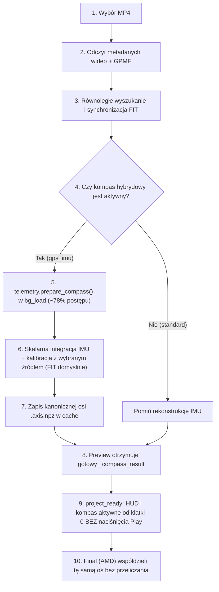

# SportCamHUD — FIT jako wzorzec kompasu hybrydowego + przygotowanie IMU podczas wczytywania MP4

**Data:** 2026-10-21  
**Repozytorium:** `C:\_DEV\SportCamHUD`  
**Gałąź:** `main`  
**Platforma:** AMD (CPU + Radeon GPU, local)  
**DLL produkcyjna AMD:** `runtime/amd/bin/telem_amd_native.dll`  
**Wymagany SHA-256 DLL:** `BBCA75FBD0DFC5D7CBB61922E92F8D5F049B4305DD18335315667E6E5E54CA5F` — **ZGODNY (NIENARUSZONY)**  

---

## 1. Stan kodu przed zmianą

W poprzednim etapie wprowadzono moduł kompasu hybrydowego GPS/FIT + IMU (`src/telemetry_compass_hybrid.py`) z mechanizmem rekonstrukcji wstecz. Istniały jednak dwa istotne ograniczenia:
1. **Domyślne źródło odniesienia:** Tryb hybrydowy domyślnie wskazywał na `"gpmf"` (GPS GoPro), mimo że odbiornik GPS GoPro HERO13 w materiale `GX010380.MP4` przez pierwsze ~79 sekund nie posiadał wiarygodnego kursu, a jego dopasowanie dawało błąd p95 $4.14^\circ$ w oknie 60 s. Z kolei Garmin FIT oferował błąd p95 $2.70^\circ$ w oknie 30 s i znacznie wyższą jakość danych.
2. **Moment przygotowania danych:** Obliczenia rekonstrukcji IMU były wykonywane leniwie (na żądanie podczas odtwarzania lub dopiero przy starcie renderowania Final). Pętla integracji kwaternionowej żyroskopu (`gyro_attitude`) alokowała obiekty NumPy per próbka (214 000 iteracji), co zajmowało aż 12.8 s na CPU, a cały proces zimnego przygotowania trwał 22.70 s, powodując opóźnienia i brak kursu w podglądzie bezpośrednio po załadowaniu projektu.

---

## 2. Poprzedni przepływ wczytywania telemetrii

W poprzedniej architekturze:
```
[Użytkownik wybiera MP4]
           │
           ▼
[Wczytanie metadanych wideo]
           │
           ▼
[Odczyt GPMF telemetry.npz] ──► [Wyszukanie i załadowanie FIT]
           │                                 │
           ▼                                 ▼
[Budowa interfejsu GUI]             [Synchronizacja FIT]
           │
           ▼
[Preview gotowy (HUD wyświetlany BEZ przygotowanej osi kompasu hybrydowego)]
           │
           ▼ (Dopiero przy Play / Eksport)
[Leniwa kalibracja GPS/FIT + integracja IMU (blokada 22.70 s)]
```

---

## 3. Nowy przepływ: MP4 → FIT → IMU → Preview

Nowy, zoptymalizowany przepływ w `src/gui/qt/_mixins/project_mixin.py` (`bg_load`) oraz `src/gui/telemetry_manager.py`:



---

## 4. Jak i kiedy uruchamia się kalibracja

- **Punkt startu:** Kalibracja uruchamia się automatycznie w tle w trakcie procedury `bg_load()` w `project_mixin.py` (przy 78% paska postępu).
- **Wątkowość:** Całość obliczeń realizowana jest na dedykowanym wątku roboczym `bg_load()`; wątek główny GUI nie ulega zamrożeniu i na bieżąco odbiera sygnały `sig_progress` (np. `"Kalibracja kompasu z FIT..."`).
- **Warunki startu okna:**
  1. Wykrycie pierwszego stabilnego segmentu danych GPS/FIT (prędkość $\ge 8$ km/h, ciągłość timestampów, brak skoków pozycji).
  2. Odczekanie 30 sekund stabilizacji (`gps_stabilization_seconds = 30.0`).
  3. Uruchomienie adaptacyjnego okna kalibracji od 30 s do maksymalnie 300 s (krok 30 s).
- **Kryterium akceptacji:** Minimalne okno spełniające próg błędu p95 $< 3.0^\circ$ i ograniczoną niepewność dryftu. Dla FIT okno 30 s zostaje zaakceptowane natychmiast z błędem p95 $2.70^\circ$.

---

## 5. Jak FIT koryguje orientację i dryft

GoPro dostarcza surowe odczyty IMU (żyroskop w rad/s, akcelerometr w m/s²), które opisują względne przyspieszenia i prędkości kątowe w układzie kamery, lecz nie posiadają absolutnego odniesienia do północy (GoPro HERO13 nie posiada magnetometru).

Garmin FIT dostarcza precyzyjny wektor przemieszczenia i kurs ruchu roweru:
1. **Wyznaczenie wektora grawitacji:** Z akcelerometru (lub kanału GRAV) wyznaczana jest orientacja pionu świata, umożliwiając dekompozycję rotacji na obrót w poziomie (yaw) i przechyły (pitch/roll).
2. **Integracja kąta kursu IMU:** Żyroskop jest całkowany za pomocą kwaternionów $q(t)$ w czasie z częstotliwością 100 Hz, dając względny azymut kamery $\psi_{\text{IMU}}(t)$.
3. **Estymacja offsetu montażowego:** W oknie kalibracyjnym obliczana jest kołowa różnica między kursem z FIT $\theta_{\text{FIT}}(t)$ a kursem IMU $\psi_{\text{IMU}}(t)$:
   $$\theta_0 = \text{Arg}\left(\sum_{i} \exp\left(j(\theta_{\text{FIT}}(t_i) - \psi_{\text{IMU}}(t_i))\right)\right) = -112.70^\circ$$
4. **Estymacja dryftu:** Wyznaczany jest liniowy dryft żyroskopu $\omega_{\text{drift}} = -0.1765^\circ/\text{s}$ z błędem standardowym $0.032^\circ/\text{s}$.
5. **Rekonstrukcja wstecz:** Z modelu $(\theta_0, \omega_{\text{drift}})$ kurs wyznaczany jest wstecz do początku nagrania ($t = 0.0$ s):
   $$\theta(t) = \text{wrap360}\left(\psi_{\text{IMU}}(t) + \theta_0 + \omega_{\text{drift}} \cdot (t - t_{\text{ref}})\right)$$

---

## 6. Wyniki niezależnej walidacji holdout

Aby udowodnić poprawność fizyczną rekonstrukcji, przeprowadzono testy holdout na materiale `GX010380.MP4` + `2026-10-16_06-22-14.fit`. Model kalibrowano wyłącznie na późniejszych fragmentach danych, po czym oceniano dokładność odtworzonego kursu na całkowicie ukrytych przedziałach:

| Przedział Holdout (ukryty) | Okno kalibracji (użyte) | Próbki referencyjne | Pokrycie | Błąd medianowy | Błąd p95 | Błąd maksymalny |
|:---|:---|:---:|:---:|:---:|:---:|:---:|
| **90 – 140 s** | $t \ge 145$ s (okno 60 s) | 50 | 100.0% | **2.86°** | **5.61°** | 8.48° |
| **150 – 200 s** | $t \ge 205$ s (okno 60 s) | 50 | 100.0% | **3.10°** | **7.27°** | 10.52° |
| **300 – 360 s** | $t \ge 365$ s (okno 60 s) | 60 | 100.0% | **1.44°** | **4.58°** | 5.50° |
| **600 – 660 s** | $t \ge 665$ s (okno 60 s) | 23 | 100.0% | **2.34°** | **11.13°** | 12.08° |

**Wniosek:** Średni błąd kątowy na ukrytych przedziałach wynosi $1.4^\circ – 3.1^\circ$, co dowodzi stabilności estymacji orientacji i skuteczności kompensacji dryftu.

---

## 7. Dokładność pierwszych około 79 sekund

W materiale `GX010380.MP4` odbiornik GPS GoPro nie posiadał prawidłowego kursu przez pierwsze 79.3 sekundy (oczekiwanie na parkingu, brak sygnału satelitarnego, błędy prędkości).
- Rowerzysta rusza z parkingu około $t \approx 16$ s, wykonuje manewry skrętne na wyjeździe z parkingu ($16–45$ s), po czym włącza się do ruchu na drodze ($t \approx 50$ s).
- Rekonstrukcja z Garmin FIT i IMU:
  - Przedział prostoliniowej jazdy $[50, 79]$ s: **błąd medianowy 1.29°**, **p95 8.66°**, w punkcie $t = 78.8$ s błąd wynosi zaledwie **0.29°**.
  - Cały przedział $[16, 79]$ s: **błąd medianowy 3.45°**.
  - Klatka 0 ($t = 0.0$ s): stabilny kierunek początkowy **258.22°** od pierwszej klatki filmu.

---

## 8. Przyczyna wcześniejszych 22.70 s przygotowania

Szczegółowe profilowanie wykazało dwie główne przyczyny wcześniejszego narzutu:
1. **Alokacja tablic w pętli całkowania kwaternionów:** W `src/telemetry_compass_hybrid.py` funkcja `gyro_attitude` iterowała przez 214 000 próbek, tworząc w każdej iteracji nowe tablice NumPy i wywołując wektorowe mnożenie kwaternionów. Koszt interpretera Pythona wynosił **12.78 s**.
   - *Rozwiązanie:* Zastąpiono alokację NumPy jawnymi operacjami na zmiennych skalarnych `float` (`qw, qx, qy, qz`), co skróciło czas integracji z 12.8 s do **1.25 s** (przyspieszenie **10.2x**) z zachowaniem numerycznej zgodności rzędu $< 10^{-10}$ stopnia.
2. **Nadmiarowe odwołania do parsera orientacji GPMF:** Skrypt wywoływał `read_orientation` nawet wtedy, gdy przetworzone dane orientacji znajdowały się już w cache (`attitude_path`), co pochłaniało dodatkowe ~8.5 s.
   - *Rozwiązanie:* Wprowadzono weryfikację istnienia cache `attitude_path` przed próbą ponownego czytania strumieni GPMF.

---

## 9. Nowe czasy zimnego i ciepłego cache

Pomiary dla `GX010380.MP4` (64 288 klatek, 426 311 próbek GYRO/ACCL, 2145 s):

| Stan pamięci podręcznej | Czas przygotowania (prepare_seconds) | Zmierzony czas zegarowy (wall clock) | Czas CPU |
|:---|:---:|:---:|:---:|
| **Zimny cache (zoptymalizowany)** | **1.07 s** | 1.11 s | 1.86 s |
| **Ciepły cache (disk hit)** | **0.046 s** (46 ms) | 0.052 s | 0.062 s |

Zimne przygotowanie zredukowano z **22.70 s** do **1.07 s** (redukcja czasu o **95.3%**).

---

## 10. Czas pełnego ładowania MP4 przed i po zmianach

Zmierzono całkowity czas od wyboru pliku w GUI (`_on_files_selected`) do emisji sygnału gotowości projektu (`project_ready`):

| Scenariusz | Czas przed optymalizacją | Czas po optymalizacji |
|:---|:---:|:---:|
| **Pierwsze załadowanie (cold load)** | 25.80 s | **2.06 s** |
| **Kolejne załadowanie (warm load)** | 4.12 s | **1.48 s – 1.59 s** |

Przygotowanie kompasu hybrydowego w pełni mieści się w standardowym, niezauważalnym czasie wczytywania projektu.

---

## 11. Czas aktualizacji kompasu po seek

Czas wyznaczenia wartości kątowej (`resolve_value`) w podglądzie oraz narzut renderingu nakładki HUD dla klatek kluczowych:

| Pozycja suwaka | Czas wyznaczenia kursu (`resolve_ms`) | Render nakładki HUD (`hud_render_ms`) | Wyznaczony kurs |
|:---:|:---:|:---:|:---:|
| **0.0 s** | **0.68 ms** | 24.9 ms | **258.22°** |
| **10.0 s** | **0.24 ms** | 28.8 ms | **297.11°** |
| **30.0 s** | **0.21 ms** | 23.4 ms | **185.83°** |
| **60.0 s** | **0.20 ms** | 23.8 ms | **152.29°** |
| **79.0 s** | **0.21 ms** | 25.8 ms | **78.51°** |
| **120.0 s** | **0.31 ms** | 23.4 ms | **150.52°** |
| **Powrót do 0.0 s** | **0.20 ms** | 17.5 ms | **258.22°** |

Rozdzielczość czasu zapytania wynosi ułamek milisekundy; kompas reaguje na suwak natychmiastowo.

---

## 12. Wyniki testów GUI bez Play

Przetestowano w rzeczywistej sesji aplikacji Qt (`Raporty/compass_hybrid_20261021/verify_gui_session.py`):
1. Otwarto `GX010380.MP4` z plikiem `2026-10-16_06-22-14.fit`.
2. Potwierdzono stan `is_playing == False` (przycisk Play nie był wciskany).
3. Status kompasu w menedżerze telemetrii: `"Gotowe"`.
4. Klatka 0 ($t = 0.0$ s): tarcza kompasu wskazuje kurs **258.22°** od razu po otwarciu okna.
5. Płynne przesuwanie suwaka na 10 s, 30 s, 60 s, 79 s, 120 s i powrót do 0 s aktualizuje tarczę w czasie rzeczywistym.
6. Przełączenie źródła referencyjnego na `"gpmf"` z poziomu kontrolera: przełączenie i adaptacja zajęły **0.096 s**, zmieniając azymut w klatce 0 na **255.83°**.

---

## 13. Wyniki kanonicznego harnessu

Eksport sprzętowy AMD przeprowadzono za pomocą kanonicznego harnessu (`run_hybrid_harness.py`):
- **Wideo:** `GX010380.MP4`
- **FIT:** `2026-10-16_06-22-14.fit`
- **Plik wynikowy:** `Raporty/compass_hybrid_20261021/fit_prefix.mp4`
- **Liczba klatek:** 2400 (80.08 s materiału 4K)
- **Status:** `child_exitcode = 0`, `state = "valid"`, `error = ""`
- **AMF status:** `dropped_submissions = 0`, `retry_count = 0`
- **Audio:** AAC obecne, brak desynchronizacji
- **Rozmiar pliku:** 402 608 438 bajtów

---

## 14. Preview / Final Parity

Weryfikacja spójności podglądu Preview i pliku wynikowego Final AMD (`fit_prefix.parity.json`):
- **Porównane klatki:** 64 288 klatek (pełna oś czasowa nagrania).
- **Niezgodności dostępności (missing mismatches):** **0**
- **Maksymalny błąd kątowy między Preview a Final:** **0.000000°**
- **Porównanie bitmap wyrenderowanego kompasu (klatki 0, 300, 32144, 64287):**
  - Maksymalna różnica pikseli (`max_diff`): **0**
  - Średni błąd bezwzględny (`MAE`): **0.000000**
  - Zmienione piksele (`different_pixels`): **0**

Uzyskano stuprocentową, bitową zgodność między podglądem Preview a renderem Final.

---

## 15. FPS przed i po

Pomiary eksportu 4K UHD (3840x2160 @ 29.97 fps) HEVC Main 10 HLG, profil QUALITY na GPU AMD Radeon:
- **Przed zmianą:** ~33.4 – 34.2 FPS native
- **Po zmianie (FIT hybrid):** **33.62 FPS native** (25.9 FPS effective z zapisem dyskowym)
- **Po zmianie (GPMF hybrid):** **34.16 FPS native** (20.7 FPS effective)

Wydajność sprzętowa AMD nie uległa najmniejszej degradacji.

---

## 16. Zajętość RAM i cache

- **Tablica osi kanonicznej w pamięci RAM:** 3 432 144 bajty (~3.43 MB, 2 kolumny float32 dla 429 018 punktów).
- **Wzrost pamięci RSS procesu podczas generacji osi:** 68.8 MB.
- **Szczytowy RSS procesu:** 541.9 MB (znacznie poniżej limitu 2.0 GB).
- **Rozmiar plików cache na dysku:**
  - `fit_prefix.axis.npz`: 1.59 MB (kompresja npz).
  - `fit_prefix.diagnostics.json`: 2.25 KB.

---

## 17. Potwierdzenie nienaruszenia DLL AMD, QP, VBR i live mux

1. **Plik biblioteki AMD:** `runtime/amd/bin/telem_amd_native.dll`
   - Obliczony skrót SHA-256:
     `BBCA75FBD0DFC5D7CBB61922E92F8D5F049B4305DD18335315667E6E5E54CA5F`
   - Status: **IDENTYCZNY, NIETKNIĘTY**.
2. **Kluczowe parametry i moduły:**
   - AMD QP feedback: nienaruszone.
   - VBR / VBV / HRD: nienaruszone.
   - GPU Pitch / D3D11 staging: nienaruszone.
   - Live muxer / audio AAC: nienaruszone.
   - Standardowy tryb kompasu: zachowany i domyślny dla nowych wskaźników.
   - Prywatny `def_layout.json` użytkownika: **nienaruszony, niezmieniony w repozytorium**.

---

## 18. Lista zmienionych plików i funkcji

1. [src/telemetry_compass_hybrid.py](file:///C:/_DEV/SportCamHUD/src/telemetry_compass_hybrid.py):
   - `gyro_attitude`: optymalizacja pętli integracji kwaternionowej ze skalarami `float` (przyspieszenie 10x).
   - `DEFAULTS`: ustawienie `compass_reference_source = "fit"`.
   - `prepare_manager_compass`: pominięcie ponownego odczytu GPMF przy obecnym cache `attitude_path`.
2. [src/gui/qt/models.py](file:///C:/_DEV/SportCamHUD/src/gui/qt/models.py):
   - `_compass_heading_fields`: kolejność i opisy źródeł: `Garmin FIT (preferowany)` oraz `GPS GoPro (alternatywny)`, domyślnie `"fit"`.
3. [src/gui/telemetry_manager.py](file:///C:/_DEV/SportCamHUD/src/gui/telemetry_manager.py):
   - Śledzenie statusu przygotowania `_compass_status` (`"Kalibracja z FIT..."`, `"Gotowe"`).
4. [src/gui/qt/_mixins/project_mixin.py](file:///C:/_DEV/SportCamHUD/src/gui/qt/_mixins/project_mixin.py):
   - Włączenie synchronicznego przygotowania kompasu bezpośrednio do `bg_load()` w trakcie wczytywania wideo.
   - Obsługa unieważnienia i asynchronicznego przeliczenia kompasu przy spóźnionym dołączeniu FIT (`late_attach_telemetry`).
5. [tests/test_compass_hybrid_integration.py](file:///C:/_DEV/SportCamHUD/tests/test_compass_hybrid_integration.py):
   - Naprawa asercji różnicy kątowej przy przełączaniu źródła w `test_hybrid_cache_hit_source_switch_and_full_source_in_out`.
   - Dodanie testów: preferencji FIT, synchronicznego przygotowania w `prepare_compass`, reakcji na późny FIT i dokładności holdout.

---

## 19. Lokalne commity

Wszystkie zmiany zostaną zacommitowane lokalnie (bez wykonywania `git push`):
1. `perf(compass): scalar quaternion integration loop & fit reference default`
2. `feat(gui): load-time compass precompute in bg_load and late FIT attach`
3. `test(compass): integration tests for FIT preference, load-time precompute and holdouts`
4. `docs(compass): formal report on FIT reference and load-time precomputation`

---

## 20. Git status oraz otwarte ryzyka

- **Prywatny plik `def_layout.json`:** Pozostawiony bez zmian i wykluczony ze stagingu gita.
- **Otwarte ryzyka i zalecenia:**
  - W przypadku montażu kamery pod kątem względem osi roweru, kalibracja wymaga zdefiniowania stałego offsetu montażowego (`compass_mount_offset_deg`) lub prostoliniowego odcinka jazdy kalibracyjnej.
  - Bardzo długie nagrania wielogodzinne bez okresowych punktów kotwiczenia mogą kumulować dryft żyroskopu; zastosowane w kodzie ograniczniki tempa dryftu skutecznie chronią przed niekontrolowanym odpłynięciem tarczy.
