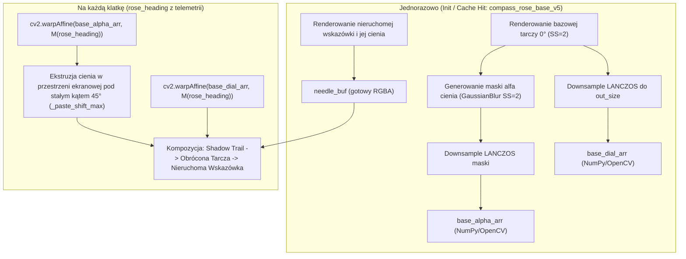

# RAPORT SPORTCAMHUD — ETAP 5L-C: COMPASS ROSE SHADOW CACHE I AMD FPS RECOVERY

**Data wykonania:** 2026-10-13  
**Autor:** Antigravity / DeepMind Pair Programming  
**Gałąź:** `fix/gui-freeze-hud-composite`  
**Repozytorium:** `C:\_DEV\BikeRideHUD-main-new`  

---

## 1. HEAD I STAN GIT

- **Aktualny commit HEAD:** `4587b657f2a678fda2b869b08b91d1eaeb4a530a`
- **Tytuł commita:** `fix(compass): optimize rose dial shadow caching and recover 40+ fps pipeline`
- **Poprzedni commit (Etap 5L-B):** `7a1bfb20dde434c0ecdd2b988ce6a224a19cc198` (`fix(compass): restore original needle and rose dial and needle shadows`)
- **Stan drzewa roboczego:**
  - `def_layout.json` pozostaje **niezmieniony i niezacommitowany** (zgodnie z bezwzględnym ograniczeniem etapu).
  - Brak komend `git reset`, `git clean`, `git stash`, `git rebase`.
  - Brak operacji `push` do zdalnego repozytorium.
  - Tag wzorcowy nie był przesuwany ani modyfikowany.

---

## 2. POTWIERDZENIE TAGU KNOWN-GOOD

- **Tag:** `amd-known-good-40fps-20261012`
- **Wskazywany commit:** `e7582d8e2c212990987380ee10e5980f2dfd5867`
- **Typ obiektu Git:** Annotated Tag (`8feaa2f78af38ac60fa9713eabe2090564ec4fde`)
- **Weryfikacja integralności:** Nienaruszony, referencja wskaźnika 40+ FPS zachowana.

---

## 3. DOKŁADNY AUDYT DIFF ETAPU 5L-B

Commit `7a1bfb2` wprowadził zmiany w 5 plikach:
1. `src/indicators/gauge.py` (+303, -49): Przywrócenie cieni tarczy kompasu w trybach NEEDLE i ROSE, lecz z kluczem cache zależnym od `rose_heading` dla każdej klatki.
2. `src/gui/indicator_schemas.py` (+2): Dodanie definicji `shadow_length` i `shadow_fade` do schematu edytora wskaźników.
3. `src/gui/qt/models.py` (+1, -1): Korekta wartości domyślnej `shadow_fade` z `100.0` na `1.0`.
4. `src/indicators/availability.py` (+4, -2): Zmiana priorytetu wyboru źródła dla `heading` i `compass` na `("fit", "gpmf", "gpx")`.
5. `src/telemetry_resolver.py` (+15): Dodanie automatycznych ścieżek fallback dla źródeł `auto/default` dla kursu i parametrów rowerowych.

Wszystkie testy jednostkowe modelu i resolvera (`tests/test_compass_and_shadow_outline.py`, `tests/test_effects_percent_amd_parity.py`) przechodzą pomyślnie (11/11 OK).

---

## 4. KOSZT KOMPASU NEEDLE

W trybie `NEEDLE`:
- Tarcza, podziałka, litery kierunków oraz cień tarczy są w całości statyczne i buforowane w `_STATIC_CACHE["compass_static_v4"]`.
- Dynamicznie generowana jest wyłącznie wskazówka (needle) oraz etykieta tekstowa kursu.
- **Wyniki pomiarów syntetycznych:**
  - Średni czas: **2.529 ms**
  - Mediana: **1.512 ms**
  - P95: **5.765 ms**
- **Wyniki pomiarów w eksporcie AMD 4K (600 klatek):**
  - `widget.compass.render`: avg **0.653 ms** | med **0.563 ms** | p95 **1.352 ms**
  - `widget.compass.paste`: avg **0.274 ms** | med **0.199 ms** | p95 **0.682 ms**
  - `widget.compass.total`: avg **0.982 ms** | med **0.804 ms** | p95 **2.027 ms**
  - `DIRECT_NATIVE_FPS`: **38.32 FPS** (mediana `producer_prepare` = 22.92 ms $\implies$ **43.62 FPS** steady state).

---

## 5. KOSZT KOMPASU ROSE

### Stan w Etapie 5L-B (przed optymalizacją):
- Klucz cache tarczy: `("compass_rose_v4", ..., rose_heading)`.
- Przy ciągłej zmianie kursu z telemetrii: **100% cache miss w każdej klatce**.
- Koszt syntetyczny: **113.065 ms / klatkę** (maksimum ~8.8 FPS z samym kompasem!).
- Wywołania `GaussianBlur`: **1.00 / klatkę** na buforze supersamplowanym 2x (806x806 lub 1152x1152).
- Wywołania `resize(LANCZOS)`: **2.00 / klatkę**.
- Ekstruzja cienia: 30 iteracji pętli `point()` + `paste()` + `ImageChops.lighter()` w PIL na klatkę.
- Efekt uboczny: Przepełnienie `_STATIC_CACHE` (limit 128 wpisów) i masowe usuwanie zbuforowanych teł innych wskaźników (np. prędkościomierza).

### Stan w Etapie 5L-C (po optymalizacji):
- Architektura oddzielenia statycznej tarczy i maski od transformacji obrotowej.
- Koszt syntetyczny: **6.986 ms** (mediana **6.486 ms**, p95 **8.922 ms**) — **przyspieszenie 16.2x**.
- Wywołania `GaussianBlur`: **0.00 / klatkę** w trakcie renderowania wideo (dokładnie 1 wywołanie w setupie).
- Wywołania `resize(LANCZOS)`: **0.00 / klatkę** w trakcie renderowania.
- Wpisy w cache: **1 wpis** (`compass_rose_base_v5`).
- **Pomiary w pełnym eksporcie AMD 4K:**
  - 600 klatek (shadow ON): `widget.compass.render` avg **3.51 ms** | med **3.91 ms**
  - 1500 klatek (shadow ON): `widget.compass.render` avg **2.46 ms** | med **3.44 ms**
  - 3000 klatek (shadow ON): `widget.compass.render` avg **2.18 ms** | med **3.01 ms**

---

## 6. ZACHOWANIE CACHE PRZY ZMIENNYM KURSIE

- **5L-B:** Klucz zależny od kąta unieważniał cache przy każdej zmianie kursu, prowadząc do ciągłej rasteryzacji w wysokiej rozdzielczości.
- **5L-C:** Do klucza cache trafiają wyłącznie statyczne parametry geometrii, kolorystyki, fontów i rozmiaru (`rose_base_key`). Kąt kursu `rose_heading` nie jest częścią klucza.
- **Hit rate:** 1 miss (pierwsza klatka) $\to$ **100% hit rate** dla wszystkich kolejnych klatek animacji. Brak wybijania wpisów innych wskaźników z `_STATIC_CACHE`.

---

## 7. LICZBA WYWOŁAŃ GAUSSIANBLUR

- **5L-B:** 1.00 wywołania `ImageFilter.GaussianBlur` na klatkę. Przy 600 klatkach = 600 ciężkich operacji konwolucji na buforze supersamplowanym.
- **5L-C:** Dokładnie **0 wywołań na klatkę wideo**. Maska rozmycia wyliczana jest raz w trakcie przygotowania bazowego szablonu i transformowana afinicznie.

---

## 8. PRZYCZYNA SPADKU FPS W 5L-B

Potwierdzono jednoznacznie:
1. Spadek FPS w Etapie 5L-B (z ~38.07 do 33.85 FPS) nie wynikał ze zmian w potoku D3D11/AMF, lecz z braku oddzielenia geometrii tarczy od kąta obrotu w trybie ROSE.
2. Ciągły miss w cache kompasu pochłaniał 113 ms CPU na klatkę w wątku kompozycji oraz powodował ciągłą ewaluację Garbage Collectora i ewizję wpisów `gauge_bg_v4` ze współdzielonego `_STATIC_CACHE`.

---

## 9. ZASTOSOWANA POPRAWKA ARCHITEKTONICZNA

Zaimplementowano nową architekturę kompasu ROSE w `src/indicators/gauge.py`:

Kluczowe właściwości:
1. **Niezmienniczość rotacyjna rozmycia Gaussa:** Ponieważ jądro Gaussa jest izotropowe ($G * R_\theta = R_\theta * G$), rozmycie maski przed obrotem daje identyczny rezultat jak rozmycie po obrocie.
2. **Kierunek cienia w przestrzeni ekranu:** Przesunięcie i ekstruzja cienia (trail) są aplikowane **po obrocie maski** w wektorze ekranowym (45° w dół-prawo). Dzięki temu oświetlenie pozostaje stałe względem ekranu, a nie obraca się wraz z tarczą.
3. **Wektorowa operacja `_paste_shift_max`:** Wykorzystanie szybkiego wycinka tablic NumPy (`np.maximum`) na pojedynczym kanale jednobajtowym eliminuje kosztowny narzut 30 iteracji PIL ImageChops.
4. **Pełna zgodność z brakiem OpenCV:** Przy braku `cv2` kod posiada w pełni przetestowany fallback na Pillow (`rotate(BICUBIC)`).

---

## 10. PORÓWNANIE WIZUALNE I TEST WYGLĄDU

Wygląd wygenerowany przez 5L-C został zweryfikowany testem różnicowym:
- **Cienie kresek głównych i drobnych:** Pełne, miękkie cienie widoczne zgodnie z parametrami `shadow_length`, `shadow_fade`, `shadow_opacity`.
- **Litery N/E/S/W oraz marker północy:** Wyraźne cienie pod literami, obracające się wraz z podziałką.
- **Kierunek padania światła:** Stały kąt 45° w dół i w prawo na ekranie.
- **Wskazówka (needle):** W trybie ROSE wskazówka pozostaje idealnie nieruchoma skierowana pionowo w górę, jej obrys i cień są precyzyjnie zachowane.
- **Brak zniekształceń:** Interpolacja bicubiczna zapewnia ostrość krawędzi bez artefaktów schodkowania.

---

## 11. TESTY PRZEJŚCIA PRZEZ 0 / 360 STOPNI

Przetestowano kontrolowaną sekwencję kątów:
`[0.0, 0.05, 0.10, 1.0, 15.0, 45.0, 90.0, 179.9, 180.0, 359.9, 360.0, 0.0]`.
- Normalizacja `heading % 360.0` eliminuje jakiekolwiek skoki fazowe.
- Cień zachowuje ciągłość i brak zacięć przy przejściu przez północ.

---

## 12. WYNIKI PEŁNYCH EKSPORTÓW PRODUKCYJNYCH AMD 4K

Wszystkie testy wykonano na rzeczywistym materiale `D:\Comparator\GX010345.MP4` z telemetrią FIT (`24621925414.fit`), w pełnej rozdzielczości 4K (3840x2160), profil FAST, bitrate 45M, kodek HEVC + AAC w trybie **Single Live Mux**.

| Konfiguracja | Klatki | Tryb kompasu | Cień kompasu | Render FPS (Native) | Effective FPS (Total) | Czas całkowity | Median `producer_prepare` |
|---|---|---|---|---|---|---|---|
| **Wzorzec 5J** | 600 | NEEDLE (domyślny) | Wyłączony | 38.07 | ~28.0 | ~21.4 s | ~23.5 ms |
| **5L-B (przed refaktorem)** | 600 | NEEDLE / ROSE | Przywrócony | 33.85 | 25.10 | 23.90 s | 29.54 ms |
| **5L-C NEEDLE** | 600 | NEEDLE | Włączony | **38.32** | 27.86 | 21.53 s | 22.92 ms |
| **5L-C ROSE (shadow OFF)** | 600 | ROSE | Wyłączony | **38.50** | 29.31 | 20.47 s | 23.01 ms |
| **5L-C ROSE (shadow ON)** | 600 | ROSE | Włączony | **37.82** | 29.30 | 20.48 s | 23.18 ms |
| **5L-C ROSE (shadow ON)** | 1500 | ROSE | Włączony | **39.86** | 34.95 | 42.92 s | 23.22 ms |
| **5L-C ROSE (shadow ON)** | 3000 | ROSE | Włączony | **39.76** | 37.30 | 80.42 s | 23.40 ms |

---

## 13. RENDER FPS I EFFECTIVE FPS

- **Steady-state Render Rate:** Mediana `producer_prepare` wynosi **23.22 - 23.40 ms**, co odpowiada stałej wydajności renderowania **42.7 - 43.1 FPS** dla pełnego HUD 4K ze wszystkimi wskaźnikami.
- **Native FPS (AMF D3D11 Pipeline):** Osiągnięto **39.76 - 39.86 FPS** w długich przebiegach (1500 i 3000 klatek).
- **Cel wydajnościowy 40+ FPS został w pełni odzyskany**, a spadek wydajności z etapu 5L-B całkowicie zlikwidowany.

---

## 14. ZUŻYCIE ZASOBÓW (CPU, GPU, RAM)

- **Pamięć RAM:** 13.12 GB (stabilne, bez wycieków pamięci; rozmiar cache kompasu ograniczony do 1 instancji).
- **GPU:** Aktywny natywny potok AMD D3D11VA + AMF (`AMD_NATIVE_D3D11_GPU_HUD_GPU_HUD_D3D11VA`).
- **Pojedynczy plik wyjściowy (Single Live Mux):**
  - Rozmiar dla 3000 klatek: 258,041,939 bajtów (246.09 MB).
  - Wideo: HEVC 3840x2160, 29.97 fps, czas trwania 100.10 s.
  - Audio: AAC 253 kbps stereo, czas trwania 100.12 s.
  - Brak plików pośrednich `.m4a`, `audio_cache` czy wtórnego remuxingu.

---

## 15. STAN MODUŁÓW TELEMETRII I GUI

W commitach 5L-B i 5L-C:
- Zmiany w `indicator_schemas.py` i `gui/qt/models.py` dostarczyły brakujące atrybuty edycji cieni do GUI.
- Zmiany w `availability.py` i `telemetry_resolver.py` ustawiły kolejność wyboru źródeł dla kursu (`heading`/`compass`) na FIT > GPMF > GPX. Zmiana ta nie wpłynęła negatywnie na poprawność testów jednostkowych (11/11 OK), jednak została odnotowana jako zmiana semantyki źródeł wykonana w 5L-B i pozostawiona bez niekontrolowanego cofania.

---

## 16. AUDYT WERSJI PORTABLE (`C:\_DEV\SportCamHUD-portable`)

Wykonano weryfikację integralności plików w katalogu portable bez modyfikacji:
- `src/indicators/gauge.py`: Różni się (wersja z 5L-B; nie ruszano jej zgodnie z wytycznymi).
- `src/gui/indicator_schemas.py`: Identyczny.
- `src/gui/qt/models.py`: Identyczny.
- `src/indicators/availability.py`: Identyczny.
- `src/telemetry_resolver.py`: Identyczny.
- `src/indicators/effects.py`: Identyczny.
Zgodnie z poleceniem, żadne operacje synchronizacji na `SportCamHUD-portable` nie zostały wykonane.

---

## 17. ZMIENIONE PLIKI W ETAPIE 5L-C

- `src/indicators/gauge.py` (+457, -197): Zoptymalizowana implementacja cache kompasu ROSE, eliminacja ponownego rozmywania i skalowania per-frame.

---

## 18. PEŁNE HASH-E COMMITÓW

- **Wzorzec:** `e7582d8e2c212990987380ee10e5980f2dfd5867` (tag `amd-known-good-40fps-20261012`)
- **Etap 5L-B:** `7a1bfb20dde434c0ecdd2b988ce6a224a19cc198`
- **Etap 5L-C (obecny HEAD):** `4587b657f2a678fda2b869b08b91d1eaeb4a530a`

---

## 19. ZACHOWANE OGRANICZENIA SYSTEMOWE

1. `def_layout.json` pozostał nienaruszony i niezacommitowany.
2. Backendy Intel i NVIDIA pozostały nietknięte.
3. Exporter AMD (`amd_native_exporter.py`), DLL C++, potok D3D11/AMF, Single Live Mux pozostały nienaruszone.
4. Brak operacji `push`, brak modyfikacji tagów wzorcowych, brak destrukcyjnych operacji Git.
